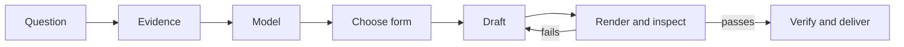

# Diagram Intelligence

[](https://github.com/drisul10/diagram-intelligence/actions/workflows/validate.yml)
[](LICENSE)
[](https://mermaid.js.org)
[](https://nodejs.org)

An agent skill for evidence-backed Mermaid and Markdown diagrams.

Most AI-drawn diagrams look complete and are partly invented: a service that does not exist, a
foreign key nobody declared, an arrow that "seems right". Diagram Intelligence makes the agent find
out before it draws, draw only what a source supports, mark what it does not know, and prove every
diagram renders.



## Features

- **Five entry points.** Analyze, Design, Build, Critique, and QA, each with its own workflow.
- **Evidence Ledger.** Every node and edge is observed (cited as `path:line`), inferred (with its
  basis), or unknown (drawn dashed and labelled `?`).
- **Hard Gates.** The diagram renders, nothing is invented, names match the source, it answers one
  question, it stays inside a size budget, it has a screen-reader title and description, and colour
  is never the only signal.
- **Real validator.** `scripts/validate.mjs` renders every `mermaid` block with Mermaid 12.3.0 in
  headless Chrome and reports `file:line`, diagram type, drawn size, and warnings. It can write light
  and dark PNGs for visual inspection.
- **Every Mermaid type.** In-depth guides for flowchart, sequence, ER, state, class, C4 and
  architecture, gantt, and mindmap, plus a reference for 24 more types. Every example in this repo is
  checked by the validator in CI.

## Entry points

| Entry point | Use it to |
| --- | --- |
| **Analyze** | read an existing diagram (Mermaid source, image, or doc) into a model |
| **Design** | draw from a brief, a description, or a conversation |
| **Build** | reverse-engineer a diagram from code, configs, schemas, logs, or docs |
| **Critique** | decide what in a diagram should change first, and why |
| **QA** | render a diagram, inspect it, and check it against its source |

The agent reads `SKILL.md` first, then loads only the capability, diagram type, and knowledge files
the task needs.

## Installation

Requires Node 22.12 or newer and a Chrome, Chromium, or Edge install.

1. Clone the repo into your agent's skills folder. For Claude Code:

   ```bash
   git clone https://github.com/drisul10/diagram-intelligence.git ~/.claude/skills/diagram-intelligence
   ```

2. Install the validator. This uses your installed browser and skips Puppeteer's download:

   ```bash
   cd ~/.claude/skills/diagram-intelligence/scripts
   PUPPETEER_SKIP_DOWNLOAD=1 npm ci
   ```

   Without a system browser, run `npx puppeteer browsers install chrome-headless-shell` in `scripts/`,
   or point `PUPPETEER_EXECUTABLE_PATH` at a browser binary. `node_modules` is about 440 MB because
   Mermaid CLI bundles fonts, KaTeX, and the ZenUML plugin.

## Usage

Ask your agent for a diagram. The skill triggers on requests such as:

```text
Draw the ER diagram for the tables in db/migrations.
Make a sequence diagram of the checkout flow in src/checkout/.
Review the architecture diagram in docs/overview.md. What should change first?
Check that every Mermaid diagram in docs/ renders.
```

Every delivered diagram comes with its Evidence Ledger, open questions for anything marked unknown,
and the validator result.

## Validator

Run it on any Markdown (`.md`, `.markdown`) or Mermaid (`.mmd`, `.mermaid`) file or directory:

```bash
node scripts/validate.mjs docs/                              # report every block
node scripts/validate.mjs docs/ --out /tmp/render --png --dark  # also write light and dark PNGs
node scripts/validate.mjs README.md --json                   # machine-readable output
node scripts/validate.mjs . --strict                         # warnings fail too
```

| Option | Effect |
| --- | --- |
| `--out DIR` | write rendered output to `DIR` |
| `--png` | write PNGs (needs `--out`) |
| `--dark` | also render with the dark theme |
| `--max-nodes N` | size budget for drawn nodes (default 25) |
| `--json` | print results as JSON |
| `--strict` | treat warnings as failures |

Exit codes: `0` all blocks pass, `1` a block failed (or warned, with `--strict`), `2` setup or usage
error.

## Project layout

```text
SKILL.md              router, workflow, evidence model, Hard Gates, Delivery Gate
capabilities/         analyze, design, build, critique, qa
knowledge/            evidence, choosing, structure, labels, style, renderers, markdown
types/                flowchart, sequence, er, state, class, architecture, gantt, mindmap, other
scripts/validate.mjs  the validator
```

## Limitations

- Validation proves a diagram renders in Mermaid 12.3.0. GitHub, GitLab, Obsidian, Notion, and docs
  sites bundle their own Mermaid versions. `knowledge/renderers.md` explains how to check a target.
- Drawn-size counts cover flowchart, class, ER, state, sequence, and swimlane. Other types report
  "not measured".
- The size budget (25 nodes, 8 participants, 30 messages) is this skill's default, not a standard.

## Contributing

Issues and pull requests are welcome. Run `node scripts/validate.mjs .` before opening a pull
request. CI runs the same check on every push and pull request.

## License

[MIT](LICENSE). The skill's structure is adapted from
[RYUX](https://github.com/ryuxdsgn/design-intelligence) (MIT). See [NOTICE](NOTICE).
