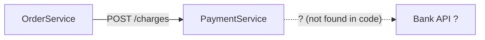

# Labels and names

> The words on a diagram are claims too. Use the source's names and say what each line does.

## Rules

### DI-LB-01 [Required] [Hard Gate] Names match the source

- Do: Name a node as the code, schema, or config names it (`OrderService`, `orders`, `payment-worker`).
  When a friendlier label helps, keep the source name visible: `pw["payment-worker (charges cards)"]`.
- Do not: Rename things to what they "really" are, or invent a name for an unnamed thing without marking it inferred.
- Why: The reader will search the code for the name on the diagram.
- Check: every node name appears in a source the ledger cites, or the ledger maps it.

### DI-LB-02 [Required] Edges say what they do

- Do: Label edges with the verb or the message: `-- "POST /orders" -->`, `-- "publishes OrderPaid" -->`,
  `-- "reads" -->`. In sequences, the message is the call or event name from the source.
- Do not: Leave edges unlabelled where more than one kind of relationship exists, or label them "uses" everywhere.
- Why: An unlabelled line says only "related somehow".
- Check: on a diagram with two or more kinds of edge, every edge is labelled or a legend explains line styles.

### DI-LB-03 [Required] One name per thing

- Do: Use one name for one element across all diagrams in a document.
- Do not: Call it "API" in one diagram and "backend" in the next.
- Check: list node names across the document's diagrams.

### DI-LB-04 [Preferred] Short labels

- Do: Keep node labels under about 30 characters per line; break with ` ` in a quoted label.
  Put detail in the caption or ledger.
- Do not: Write sentences inside boxes.
- Why: Long labels widen nodes and push the layout apart.
- Check: the PNG has no node much wider than its neighbours.

### DI-LB-05 [Required] Unknown looks unknown

- Do: Draw an unknown edge dashed with a `?` label, and an unknown element with a `?` in its label.
  Say what it means in the caption.
- Do not: Draw a guess with a solid line.

## Syntax for safe labels

- Quote any label with punctuation: `a["Check stock (async)"]`. Quoted labels may contain `:`, `;`, `(`, `)`.
- A double quote inside a label: `#quot;`. A `#` sign: `#35;`. Characters use HTML entity numbers: `#9829;`.
- Line break inside a quoted label: ` `.
- Markdown in labels: wrap the label in backticks inside quotes: ``a["`**bold** and _italic_`"]``.
- Do not use `end` as a flowchart node id; use it only inside a label.
- Ids must be one word; the label carries the display text: `pay_svc["Payment service"]`.
