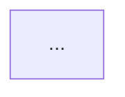

# Diagrams inside Markdown

> A diagram in a document needs words around it: what it answers, where it came from, and what it does not show.

## Rules

### DI-MD-01 [Required] Caption with the question and scope

- Do: Put one line above or below the diagram: what it shows, the scope, and the date or commit it
  was drawn from. Example: "Checkout request path, from `src/checkout/` at `a1b2c3d` (2026-11-22)."
- Do not: Drop a diagram under a heading with no text.
- Why: A reader needs to know if it is current and what is left out.

### DI-MD-02 [Required] Open questions under the diagram

- Do: When the ledger has unknown rows, list them under the diagram as "Open questions", each with
  who could answer it if known.
- Do not: Hide unknowns in the reply only, where the next reader of the document will not see them.

### DI-MD-03 [Preferred] Sources line, ledger when the reader needs it

- Do: Add a "Sources:" line listing the paths read. Include the full Evidence Ledger as a table when
  the document is a review, audit, or onboarding guide; otherwise the counts are enough.

### DI-MD-04 [Preferred] Markdown forms that beat a diagram

Use these instead of Mermaid when DI-CH-03 applies:

| Need | Markdown form |
| --- | --- |
| Compare items on the same attributes | table |
| A strict sequence with no branches | numbered list |
| A hierarchy of named parts | nested bullet list |
| A folder or file layout | fenced `text` block with a tree |
| Fields of a record, columns of a table | table: name, type, required, notes |
| Before and after | table with two columns |
| A decision and its options | table: option, pros, cons, chosen |

```text
src/
├── api/          HTTP routes and handlers
├── services/     business logic
└── db/
    ├── migrations/
    └── models/
```

### DI-MD-05 [Required] Diagram and text agree

- Do: When the text around a diagram names elements, steps, or counts, they match the diagram.
- Do not: Update one without the other.
- Check: names in the surrounding paragraphs appear on the diagram.

## Document template

````markdown
### <Diagram title>

<One line: what it shows, scope, source commit or date.>



Sources: `path/a`, `path/b`. Legend: dashed = unknown.

Open questions:
1. <unknown> (ask: <who>)
````
