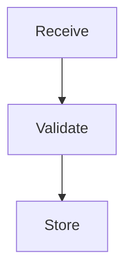

# Structure and size

> The reader should find the main path in five seconds. Size, direction, grouping, and order decide whether they can.

## Rules

### DI-CX-01 [Required] [Hard Gate] Size budget

- Do: Keep to 25 nodes for flowchart, class, ER, state, and architecture diagrams, and to 8
  participants and 30 messages for a sequence. Count from the validator output; for types it does
  not measure (C4, architecture-beta, block, and the chart types), count elements in the source.
- Do not: Fit a whole system on one diagram by shrinking it.
- Why: Past this size readers stop following lines and start searching; on a doc page the render is
  scaled down until labels are unreadable. The numbers are this skill's defaults, not a standard.
- Check: validator `nodes=` or `actors=`/`messages=`, or the source count; over budget needs a split or a written reason
  (`--max-nodes N` with the reason in SIZE).

### DI-CX-02 [Required] Split by level, flow, or area

- Do: Split an over-budget diagram into an overview (each area one node) plus one diagram per area,
  one sequence per use case, or one ER per schema area. Name the link in the overview node:
  `billing["Billing (diagram 3)"]`.
- Do not: Split arbitrarily in the middle of a flow, or drop edges to get under budget.
- Why: A split along a real boundary keeps each diagram answerable on its own.
- Check: each part passes DI-CH-01 on its own.

### DI-CX-03 [Preferred] Direction follows the reading

- Do: `TD`/`TB` for processes and hierarchies, `LR` for pipelines and request paths with few steps,
  `LR` for C4-style container views. Keep the main path straight in that direction.
- Do not: Use `LR` for a flow longer than about 8 steps on a doc page; it becomes a thin strip.
- Why: The eye follows the declared direction first.
- Check: in the PNG, the main path runs in one direction without doubling back.

### DI-CX-04 [Preferred] Declare in reading order, group what belongs together

- Do: Declare the main path first, in order, then branches, then error paths. Use subgraphs (or
  boundaries, namespaces, composite states) for real boundaries: a deployable, a team, a trust zone.
- Do not: Group by visual convenience, or nest groups more than two deep.
- Why: Layout engines place nodes partly by declaration order; a group claims "these belong together".
- Check: every group has a name the source uses (a service, a namespace, a VPC).

### DI-CX-05 [Required] Failure paths when the question includes them

- Do: When the question is about behaviour (a request, a job, a payment), draw the failure, timeout,
  and retry paths the source shows, or list them as not shown.
- Do not: Draw only the happy path and call the flow complete.
- Why: Failure handling is usually why someone needs the diagram.
- Check: the ledger has a row for each failure path found in the source, drawn or listed as out of scope.

### DI-CX-06 [Contextual] Layout engine

- When: a Mermaid 12 render looks wrong (edges routed around groups, a feedback loop pulled out of place).
- Do: Try `config: layout: dagre` in front matter, or the reverse, and keep the one that reads better.
  Remember older renderers only have dagre, so a diagram tuned for ELK may lay out differently there.
- Do not: Rely on fine placement; any renderer may move things.
- Check: the PNG after the change.

