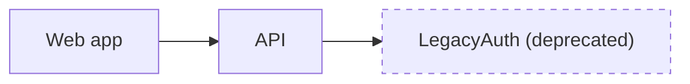

# Style, accessibility, and dark mode

> Style carries meaning or gets out of the way. It must survive dark mode and readers who do not see colour.

## Rules

### DI-A11Y-01 [Required] [Hard Gate] Named for screen readers

- Do: Put `accTitle: <short name>` and `accDescr: <one or two sentences: what it shows and the main finding>`
  right after the diagram keyword. Long descriptions use `accDescr { ... }`.
- Do not: Repeat the node list in the description. Say what the diagram means.
- Why: Mermaid writes these into the SVG's `<title>` and `<desc>`; without them the diagram is an unnamed image.
- Check: validator warning DI-A11Y-01 is absent.

Some types cannot carry them. Measured on Mermaid 12.3.0 by rendering each type with and without the lines:

| Support | Types |
| --- | --- |
| `<title>` and `<desc>` in the SVG | flowchart, sequence, class, state, ER, gantt, architecture-beta, journey, gitGraph, pie, quadrantChart, xychart, requirement, packet, radar, treemap, usecase, swimlane, treeView, cynefin, wardley, railroad, agentflow |
| description only (`accTitle` dropped) | C4 diagrams |
| silently ignored | timeline, eventmodeling |
| drawn as visible content | kanban (a card), ishikawa (a branch), zenuml (text) |
| parse error | mindmap, block, sankey, venn |

For the last three rows, leave the lines out and put a bold title and a one-sentence summary in the
Markdown right above the diagram. The validator knows this list and says which applies.

### DI-A11Y-02 [Required] [Hard Gate] Colour never carries meaning alone

- Do: When colour marks a meaning (new, deprecated, external, failing), also mark it with a label
  word, a shape, a dashed line, or a legend line in the caption.
- Do not: Rely on red versus green.
- Check: describe the diagram without colour words; nothing is lost.

### DI-ST-01 [Preferred] Style by role with classDef

- Do: Define a few roles once (`classDef external`, `classDef deprecated`) and assign them
  (`class a,b external`, or `a:::external`). Keep to three roles or fewer.
- Do not: Style nodes one by one with `style`, or colour for decoration.
- Why: Roles keep the meaning consistent and make one place to change.

### DI-ST-02 [Required] Survives dark mode

- Do: Prefer no custom colours: platform themes switch light and dark for you. When you must set
  colours, set `fill`, `stroke`, and `color` together so text contrast holds on both, and check
  the `--dark` render.
- Do not: Set only `fill` (text keeps the theme colour and may vanish), or hard-code a theme with
  `%%{init: {"theme": ...}}%%` in a document others view in dark mode.
- Why: Platforms render the same source in light and dark; a hard-coded fill is fixed in both.
- Check: validator warning DI-ST-02 lists hard-coded colours; look at the dark PNG.

### DI-ST-03 [Contextual] Legends

- When: line styles, shapes, or colours mean different things.
- Do: Explain them in one caption line under the diagram ("dashed = unknown, thick = synchronous call").
  A legend drawn inside the diagram as fake nodes adds edges the layout must place.
