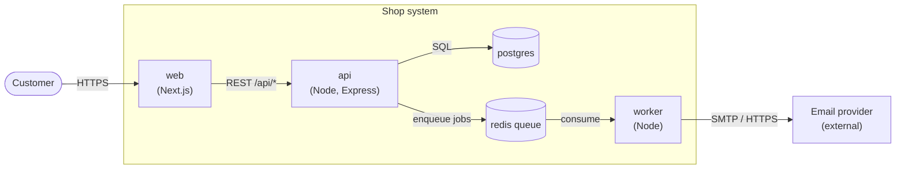
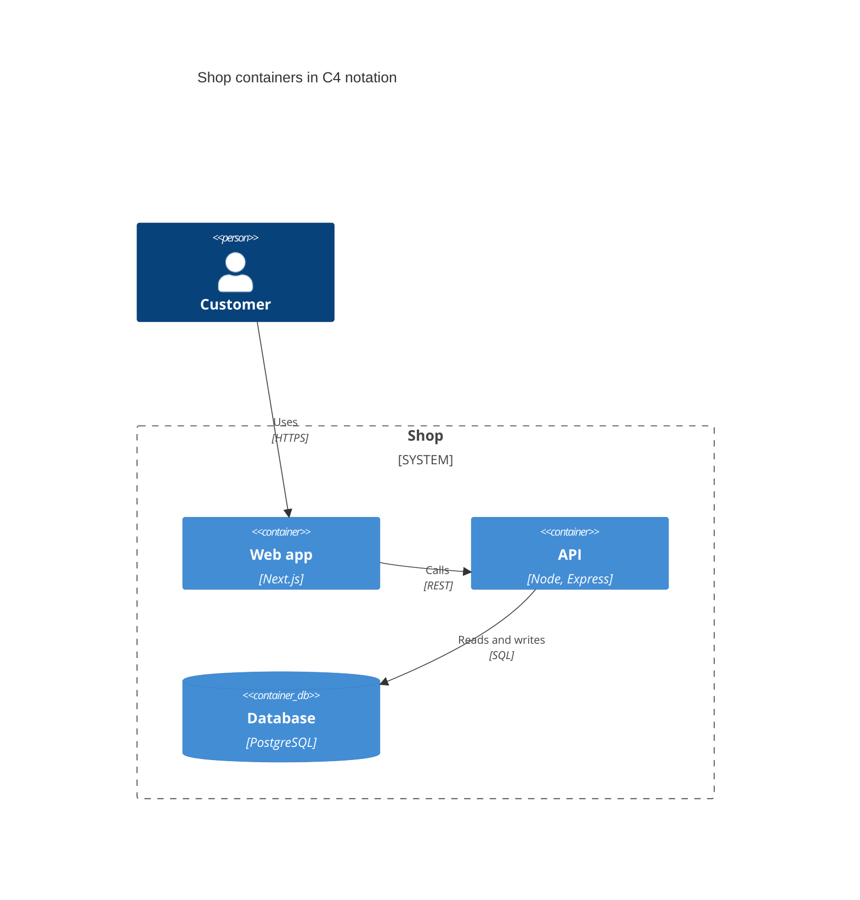
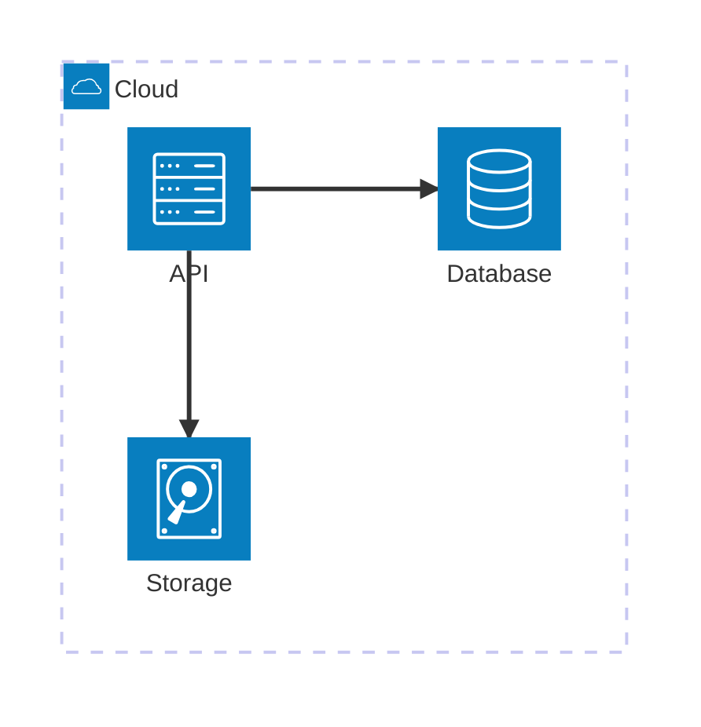

# Architecture: C4, architecture-beta, and flowchart system views

> What runs, where, and what talks to what. Pick the zoom level first.

## Choose the zoom level (C4 model)

| Level | Elements | Answers |
| --- | --- | --- |
| Context | the system as one box, its users, external systems | who uses it, what it depends on |
| Container | deployable units: apps, APIs, workers, databases, queues | what runs and how they talk |
| Component | modules inside one container | how one container is organised |
| Code | classes | use `types/class.md` |

One diagram, one level (DI-CH-01). An overview is a Context or Container diagram; drill-downs are
Component diagrams, one per container.

## Which syntax

| Option | Use when | Limits |
| --- | --- | --- |
| `flowchart LR` with subgraphs | default; renders almost everywhere; edge labels | no C4 semantics beyond your labels |
| `C4Context` / `C4Container` / `C4Component` / `C4Dynamic` / `C4Deployment` | the team uses C4 and the target supports it | layout control is limited; marked experimental upstream |
| `architecture-beta` | cloud and deployment views with icons, target known to support it | no edge labels; beta |

### Default: flowchart container view

### C4

C4 elements: `Person`, `Person_Ext`, `System`, `System_Ext`, `SystemDb`, `Container`, `ContainerDb`,
`ContainerQueue`, `Component`, boundaries `Enterprise_Boundary`, `System_Boundary`,
`Container_Boundary`, relations `Rel(from, to, label, ?tech)`, `BiRel`, `Rel_D/U/L/R` for direction,
`UpdateLayoutConfig($c4ShapeInRow="3", $c4BoundaryInRow="1")`.

### architecture-beta

Syntax: `group id(icon)[Title] (in parent)?`, `service id(icon)[Title] (in group)?`,
`a:R --> L:b` (sides `T`, `B`, `L`, `R`), `junction id`. Built-in icons: `cloud`, `database`, `disk`,
`internet`, `server`. No edge labels: put the protocol in the caption or use a flowchart.

## Rules

### DI-AR-01 [Required] [Hard Gate] Every container and connection is observed or marked

- Do: Containers from compose, manifests, Terraform, Procfiles, or deploy configs; connections from
  client code, env vars naming a host, or config. A connection seen only in an env var is inferred.
- Do not: Add a load balancer, CDN, cache, or monitoring stack because systems like this have one.
- Check: ledger row per box and per line.

### DI-AR-02 [Required] Label technology and protocol

- Do: Put the technology in the node (`api (Node, Express)`) and the protocol or verb on the edge
  (`REST`, `gRPC`, `SQL`, `publishes OrderPaid`), from the source.
- Do not: Use vendor logos or icons as the only label.

### DI-AR-03 [Required] External systems look external

- Do: Mark systems outside the boundary: outside the subgraph, `_Ext` in C4, and the word "external".

## Pitfalls

- Edge direction is the direction of the call (who initiates), not of the data; say so in the caption
  when data flows the other way (a worker polling a queue).
- C4 diagrams ignore most theme settings and lay out in rows; when the layout is unreadable, use the
  flowchart form.
- Never put real internal hostnames, IPs, or secrets from config into labels.
