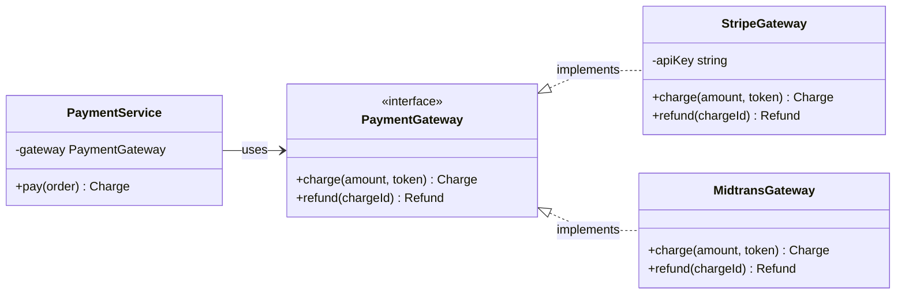

# Class diagram

> The code's types and how they relate: inheritance, composition, dependency.

Use for the structure of a module or domain model in code: classes, interfaces, their key members,
and relationships. Not for the database (ER) or runtime calls (sequence).

## Syntax essentials

| Need | Syntax |
| --- | --- |
| Inheritance, implementation | `Base <\|-- Child`, `Interface <\|.. Impl` |
| Composition, aggregation | `Whole *-- Part`, `Whole o-- Part` |
| Association, dependency | `A --> B`, `A ..> B` |
| Multiplicity | `Order "1" --> "*" Item` |
| Members | `+public`, `-private`, `#protected`, `~package`; method `name(args) ReturnType` |
| Stereotype | `<<interface>>`, `<<abstract>>`, `<<enum>>` inside the class |
| Generics | `class Repo~T~` |
| Namespace | `namespace payments { class A }` |

## Rules

### DI-CL-01 [Required] Relationships are the code's

- Do: Inheritance from `extends`/`implements`; composition from a field the owner creates and owns;
  association from a field of another type; dependency from a parameter or local use.
- Do not: Choose an arrow for how related things feel.
- Check: each relationship cites the declaration line.

### DI-CL-02 [Preferred] Members the question needs

- Do: Show the public API or the fields that explain relationships. Leave private helpers out.
- Do not: Paste whole classes.

### DI-CL-03 [Contextual] Languages without classes

- When: Go structs and interfaces, TypeScript types, Rust traits, functional modules.
- Do: Map structs/types to classes, interfaces/traits to `<<interface>>`, implicit interface
  satisfaction (Go) to `..|>`-style implementation marked inferred unless asserted in code.

## Pitfalls

- Generic syntax uses `~T~`, not `<T>`; `<` starts an arrow.
- A method's return type goes after the parentheses with a space.
- Relationship labels follow ` : label`.
