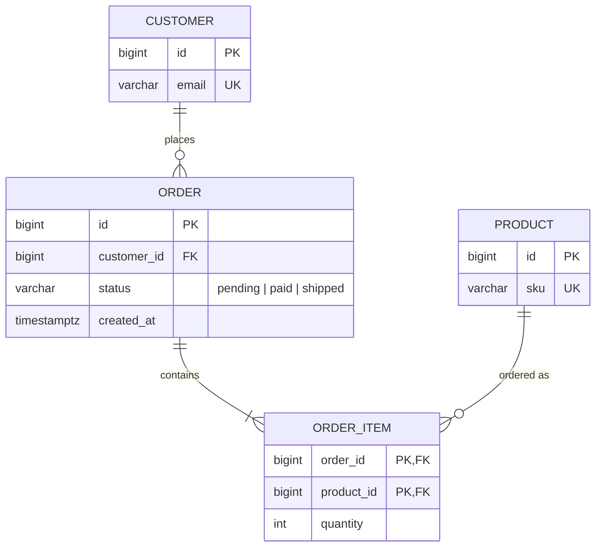

# Entity relationship diagram

> What data exists and how it is related. Every line is a foreign key or a stated rule.

Use for a database schema, or a domain data model agreed with the user. Not for code structure
(class) or one table's columns (Markdown table, DI-CH-03).

## Syntax essentials

| Need | Syntax |
| --- | --- |
| Relationship | `A <left><line><right> B : label` |
| Ends | `\|\|` exactly one, `o\|` zero or one, `}\|` one or more, `}o` zero or more (mirrored on the left) |
| Identifying vs. non-identifying | `--` solid vs. `..` dashed |
| Attribute | `type name`, then optional `PK`, `FK`, `UK` (comma-separated), then optional `"comment"` |
| Display name | `ORDER_ITEM["Order item"] { ... }` |

## Rules

### DI-ER-01 [Required] [Hard Gate] Cardinality comes from the schema

- Do: Read each relationship's ends from the schema: a non-null FK column means "exactly one" on the
  parent side; a nullable FK means "zero or one"; a unique FK means one-to-one. Many-to-many is a
  join table drawn as its own entity.
- Do not: Guess `||--o{` because it is common. When the schema does not decide it (an app-level rule,
  a document store), draw `..` and mark the label with `?`, and list it under Open questions.
- Check: each relationship row in the ledger cites the FK or constraint.

### DI-ER-02 [Required] Names are the table and column names

- Do: Use table names as in the schema (case may be normalised for readability; say so) and column
  names exactly. Types as the schema writes them.
- Do not: Rename `usr_acct` to `User` without a display name and a ledger mapping.

### DI-ER-03 [Preferred] Show the columns that explain the relationships

- Do: Include PK, FK, UK, and the columns the question is about. List the rest in a Markdown table
  under the diagram when the reader needs them.
- Do not: Dump 40 columns per entity into the diagram.

### DI-ER-04 [Contextual] Document stores and ORMs without FKs

- When: MongoDB, DynamoDB, or an ORM where relations are by convention.
- Do: Draw embedded documents as attributes (`json items`) or as a separate entity with an
  identifying `--` line labelled "embeds"; draw references as `..` lines labelled "refs by <field>".
  Mark convention-based links inferred.

## From code

| Source | Becomes |
| --- | --- |
| `CREATE TABLE`, migrations (newest wins) | entities and attributes |
| `REFERENCES`, `FOREIGN KEY`, ORM `belongsTo`/`ForeignKey`/`@ManyToOne` | relationships and their ends |
| `NOT NULL` on the FK | `\|\|` on the parent side; nullable = `o\|` |
| `UNIQUE` on the FK | one-to-one |
| Prisma `@relation`, Mongoose `ref:` | relationships; Mongoose `ref` is a convention, mark inferred unless enforced |

## Pitfalls

- An attribute type or name with a space fails to parse: `varchar(255) email` works, `var char email` does not.
- An entity name with a space needs a display alias: `ORDER_ITEM["Order item"]`.
- The relationship label is required; use `""` only when there is truly nothing to say.
