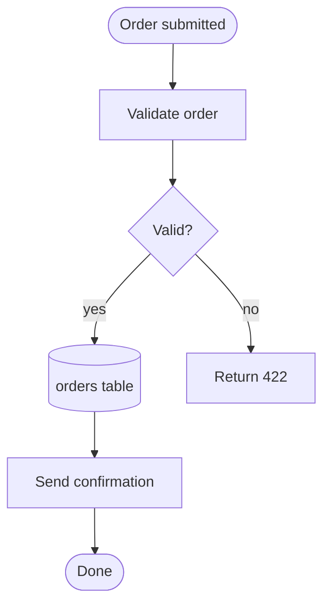

# Flowchart

> Steps, decisions, and paths. Also the general-purpose graph for module maps and simple system views.

Use when the question is "what happens, in what order, with which decisions?", or "what depends on
what?" (module graph, pipeline). Not for one thing changing state (state), calls between actors over
time (sequence), or data structure (ER).

## Syntax essentials

| Need | Syntax |
| --- | --- |
| Direction | `flowchart TD` (or `TB`), `LR`, `BT`, `RL` |
| Process, decision, start/end, data store, subroutine | `a[Text]`, `a{Text}`, `a([Text])`, `a[(Text)]`, `a[[Text]]` |
| Input/output, round | `a[/Text/]`, `a(Text)` |
| Edge, labelled edge | `a --> b`, `a -- label --> b` or `a -->|label| b` |
| Dashed (unknown or async), thick (main path), no arrow | `a -.-> b`, `a ==> b`, `a --- b` |
| Chains and fan-out | `a --> b --> c`, `a --> b & c` |
| Group | `subgraph id [Title]` ... `end`; `direction LR` inside to change its direction |
| Role styling | `classDef ext stroke-dasharray: 4 4` then `a:::ext` |

Mermaid 12 also has `a@{ shape: ..., label: "..." }` shapes, edge ids, and animated `step` edges.
Use them only when the target supports them (`knowledge/renderers.md`, DI-RN-02).

## Rules

### DI-FC-01 [Required] One shape vocabulary

- Do: rectangle = step, diamond = decision, stadium = start/end, cylinder = data store, subroutine =
  a step drawn in another diagram. Keep that meaning across the document.
- Do not: Pick shapes for variety.
- Check: every shape used maps to one meaning; say it in the legend if it is not the standard one.

### DI-FC-02 [Required] Decisions are questions with labelled exits

- Do: Write a decision as a short question (`{Paid?}`) and label every outgoing edge (`yes`, `no`, `timeout`).
- Do not: Leave a diamond with unlabelled exits, or put an action inside a diamond.
- Check: every `{}` node has two or more labelled outgoing edges.

### DI-FC-03 [Required] Every path ends

- Do: Each path ends in an end node, a hand-off to another diagram (subroutine), or a loop back.
- Do not: Leave a dead end that is not an end.
- Check: in the PNG, every node except end nodes has an outgoing edge.

### DI-FC-04 [Preferred] Subgraphs are real boundaries

- Do: Group by deployable, team, trust zone, or stage. Edges may cross into a subgraph; link to a
  subgraph id only when the target is the whole group.
- Do not: Use subgraphs as decoration, or nest more than two levels.

## From code

| Source | Becomes |
| --- | --- |
| `if`/`switch`/guard clauses in a handler | decisions with labelled exits |
| early `return`/`throw` with status codes | end nodes (`Return 422`) |
| CI `jobs` with `needs:` | nodes and edges in `LR`, one subgraph per stage |
| imports between modules | edges `a --> b` meaning "imports"; say so in the caption |

## Pitfalls

- `end` cannot be a node id. Write `done[end]` or `done([End])`.
- A label with punctuation needs quotes: `a["retry (3x)"]`.
- An id starting with `o` or `x` right after `--` makes a circle or cross edge (`a --oB`); put a space: `a --> oB`.
- Long `LR` chains become thin strips on a doc page; switch to `TD` after about 8 steps.
