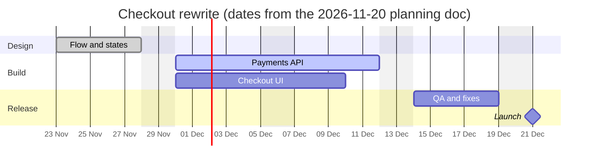

# Gantt chart

> A plan: tasks, durations, dependencies, and milestones on a calendar.

Use when the reader needs what happens when and what waits on what. Not for a history with no
durations (timeline) or a process (flowchart).

## Syntax essentials

| Need | Syntax |
| --- | --- |
| Task | `Name :id, start, duration` or `Name :id, start, end` |
| Dependency | `after id` (several: `after a b`) |
| Status | `done`, `active`, `crit` before the id |
| Milestone | `:milestone, id, date, 0d` |
| Calendar | `dateFormat`, `axisFormat`, `excludes weekends`, `excludes 2026-12-25` |
| Today marker | shown by default; `todayMarker off` to hide |

## Rules

### DI-GT-01 [Required] [Hard Gate] Dates and durations come from the user or the plan

- Do: Use the dates, durations, and dependencies the user or the plan document gives, and say where
  they came from in the title or caption.
- Do not: Estimate durations yourself and draw them as a plan. If the user asks for an estimate,
  label the chart "Estimate by <who>, not a commitment" and keep the assumptions in the caption.
- Check: each task's duration cites a source or the estimate label is present.

### DI-GT-02 [Required] Dependencies are real

- Do: Use `after` only where the plan says one task waits for another.
- Do not: Chain everything sequentially because it looks tidy.

### DI-GT-03 [Preferred] Sections by team or phase, under 20 tasks

- Do: Group tasks in sections by owner or phase; split longer plans by phase.

## Pitfalls

- `after` an unknown id renders with no error and places the task at today's date. The validator
  warns about it (DI-GT-02); check every id it names.
- `excludes weekends` stretches durations over weekends; say so when the dates matter.
- The `:` before the task metadata is required. A `:` inside a task name cuts the name silently
  (`Fix: login` shows as `Fix`); rephrase it.
