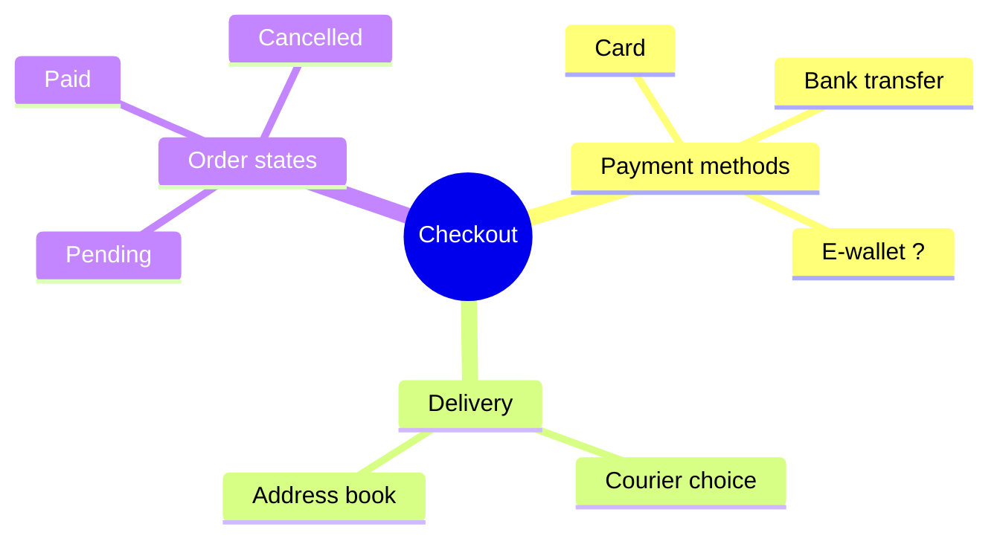

# Mindmap

> The parts of a topic, from one centre outward. Hierarchy by indentation.

Use for scoping, brainstorming output, a feature breakdown, or the map of a document set. Not when
the parts have flow or relationships between branches (flowchart). A nested Markdown list says the
same thing and diffs better; use a mindmap when the radial picture helps the reader see balance or gaps.

## Syntax essentials

Mindmap cannot carry `accTitle`/`accDescr` (a parse error in Mermaid 12.3.0), so the title and
summary go in the Markdown around it:

**Checkout scope.** The checkout project splits into payment methods, delivery, and order states;
`?` marks items not confirmed.

| Need | Syntax |
| --- | --- |
| Hierarchy | indentation (consistent spaces) |
| Shapes | `id[square]`, `id(rounded)`, `id((circle))`, `id))bang((`, `id)cloud(`, `id{{hexagon}}` |
| Icon, class | `::icon(fa fa-book)`, `:::className` on the next line |
| Markdown text | ``"`**bold** text`"`` |

## Rules

### DI-MM-01 [Required] Branches come from the source

- Do: Take branches from the brief, the doc headings, or the folder structure, and mark open or
  unconfirmed items with `?`.
- Do not: Fill a branch with typical sub-items to balance the picture.

### DI-MM-02 [Preferred] Three levels, seven branches

- Do: Keep to about three levels and seven first-level branches; move deeper detail to a list or a
  second mindmap.

## Pitfalls

- `accTitle`/`accDescr` break a mindmap; describe it in the surrounding Markdown (DI-A11Y-01).
- Indentation decides the tree; mixing tabs and spaces breaks it.
- Mermaid 12 lays mindmaps out with cose-bilkent; older renderers differ. Do not rely on positions.
- Icons need the platform to load the icon font; many do not (DI-RN-02).
