# Other Mermaid types

> Every Mermaid type outside the core set: when to use it, the syntax that matters, and its traps.

All examples render on Mermaid 12.3.0 (checked with `scripts/validate.mjs`). **Target** says how far
to trust other renderers: *established* types have existed for several major versions; *new* types
arrived recently or carry `-beta`, so check the target first (DI-CH-04, `knowledge/renderers.md`).
**A11y** says whether `accTitle`/`accDescr` work (`knowledge/style.md`); where they do not, put a bold
title and a one-line summary in the Markdown above the diagram.

The evidence rules apply to every type: no invented numbers, scores, dates, or items (DI-EV-01).
Charts (pie, xychart, sankey, quadrant, radar, treemap) need a source for every value.

## Contents

| Type | Keyword | Use for | Target | A11y |
| --- | --- | --- | --- | --- |
| User journey | `journey` | user steps scored by satisfaction | established | yes |
| Timeline | `timeline` | events by period, no durations | established | Markdown |
| Quadrant chart | `quadrantChart` | items placed on two axes | established | yes |
| Sankey | `sankey` | flows of quantity between stages | established (was `sankey-beta`) | Markdown |
| XY chart | `xychart` | bar and line series over a category axis | established (was `xychart-beta`) | yes |
| Git graph | `gitGraph` | branching and merge strategy | established | yes |
| Pie | `pie` | parts of one whole, few parts | established | yes |
| Block | `block` | layouts where you place blocks in columns | established (was `block-beta`) | Markdown |
| Packet | `packet` | bit and byte layouts of a message | established (was `packet-beta`) | yes |
| Kanban | `kanban` | work items by column | established | Markdown |
| Requirement | `requirementDiagram` | requirements traced to elements | established | yes |
| Radar | `radar-beta` | several options scored on the same axes | new | yes |
| Treemap | `treemap-beta` | hierarchy sized by quantity | new | yes |
| Venn | `venn-beta` | overlap between sets | new | Markdown |
| Use case | `usecase-beta` | actors and what they can do in a system | new (12.0) | yes |
| Swimlane | `swimlane-beta` | a process across roles or teams | new | yes |
| Tree view | `treeView-beta` | a file or folder tree | new | yes |
| Ishikawa | `ishikawa-beta` | causes of one effect, by category | new | Markdown |
| Cynefin | `cynefin-beta` | sorting problems into Cynefin domains | new | yes |
| Wardley map | `wardley-beta` | value chain against evolution | new | yes |
| Railroad | `railroad-ebnf-beta` (also `-abnf-`, `-peg-`, `railroad-beta`) | grammar syntax | new | yes |
| Event modeling | `eventmodeling` | commands, events, views over time | new | Markdown |
| Agent flow | `agentflow-beta` | AI agent steps, tools, decisions | new | yes |
| ZenUML | `zenuml` | sequence in code-like syntax | plugin; many targets lack it | Markdown |

---

## User journey (`journey`)

Use for the steps a user takes for one task, scored 1 to 5 per actor. The scores must come from
research or the user; without them, use a flowchart or a numbered list.

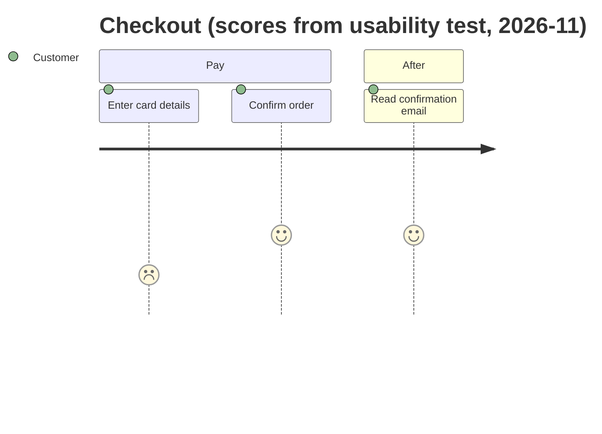

Traps: the task line is `Task: score: actor, actor`. Scores outside 1-5 render oddly.

## Timeline (`timeline`)

Use for what happened in which period, at a coarse grain: release history, incidents by month.
No durations or dependencies (use gantt).

**Release history.** Version 1.0 shipped in October and two minor versions in November.

```mermaid
timeline
  title Releases (from git tags)
  2026-10 : v1.0
  2026-11 : v1.1 : v1.2
```

Traps: `accTitle`/`accDescr` are silently ignored. Several events in one period: chain with ` : `.

## Quadrant chart (`quadrantChart`)

Use to place items on two axes (effort and value, reach and engagement). Every coordinate needs a
source or an explicit "team estimate" label.

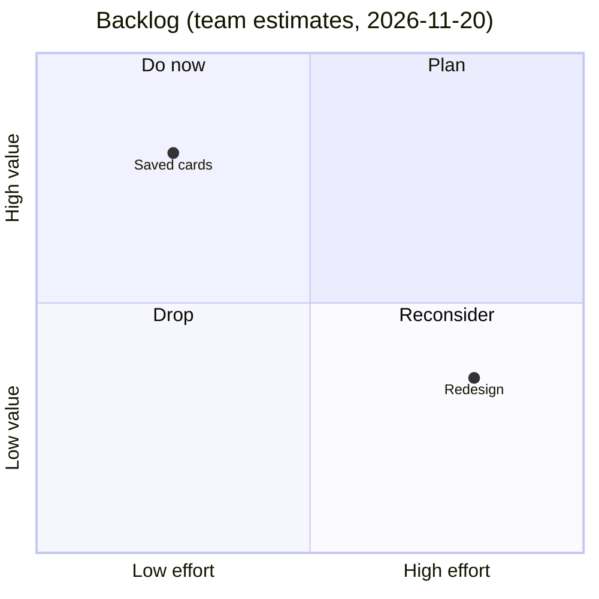

Traps: coordinates are 0 to 1. `quadrant-1` is top right, then counter-clockwise.

## Sankey (`sankey`)

Use for quantities flowing between stages (a funnel, a budget split, energy flows). Values must
balance at each node, or the picture lies.

**Signup funnel, November.** Of 1000 visits, 400 signed up and 100 of those paid.

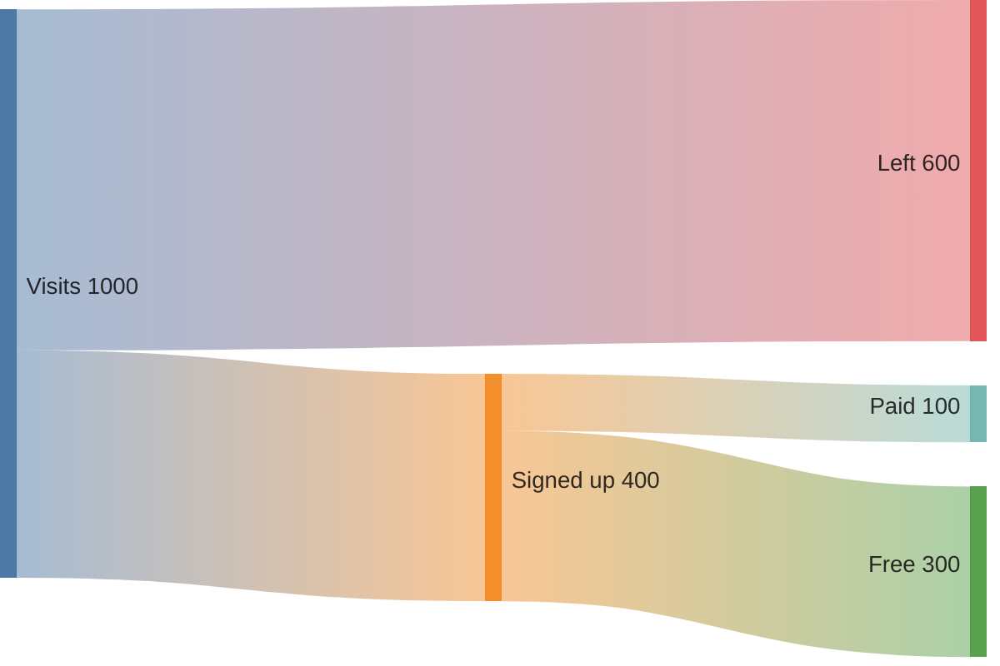

Traps: CSV rows `source,target,value`; a blank line after the keyword is allowed. Quote names with
commas: `"Fees, taxes"`. `accTitle` breaks it. For an unknown target write `sankey-beta` (DI-RN-02).

## XY chart (`xychart`)

Use for one or two series over a category or numeric axis. For anything richer, use a charting tool.

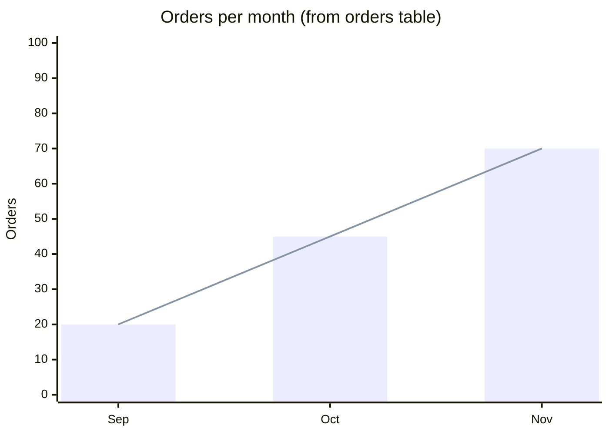

Traps: for an unknown target write `xychart-beta`, which 12.3.0 also accepts (DI-RN-02). `xychart horizontal` flips the axes. Named series
(`bar "2025" [...]`) get a legend.

## Git graph (`gitGraph`)

Use to explain a branching or release strategy, not to reproduce real history.

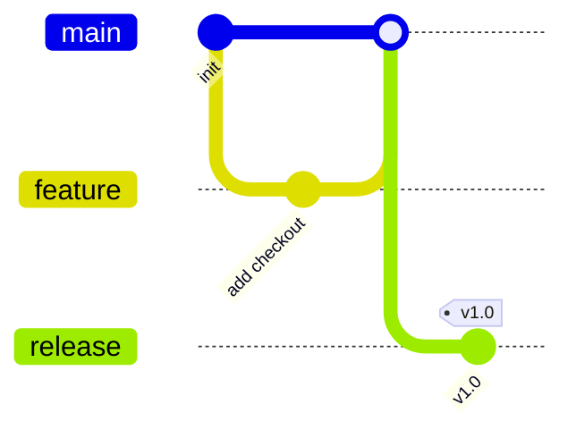

Traps: keyword is `gitGraph` (capital G). `checkout` a branch before committing to it. Branch names
with `/` need quotes: `branch "feat/x"`.

## Pie (`pie`)

Use for parts of one whole with few parts (up to about 6). For comparison across groups, use a
table or an xychart.

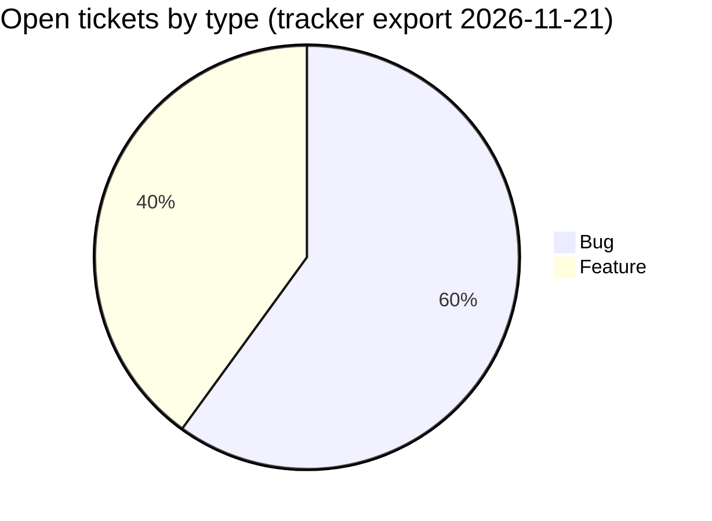

Traps: values must be positive. `showData` after `pie` prints values.

## Block (`block`)

Use when you need to control placement: a layered architecture, a memory layout, a grid. The author
places blocks in columns; the layout engine does not.

**Three-tier layout.** Web calls the API, which uses the database.

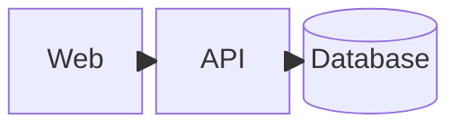

Traps: `accTitle` breaks it. `columns N` sets the grid; `space` leaves a cell empty; `block:id ... end`
nests. For an unknown target write `block-beta` (DI-RN-02).

## Packet (`packet`)

Use for bit-level or byte-level layouts of a header or message, from a spec.

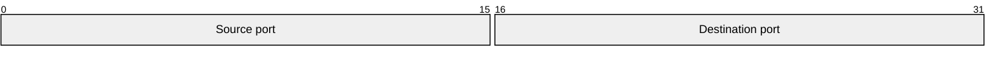

Traps: ranges are inclusive bit offsets and must not overlap. For an unknown target write `packet-beta` (DI-RN-02).

## Kanban (`kanban`)

Use to show work items by status at one moment. A table is often clearer and diffs better.

**Sprint board, 2026-11-22.** One item to do, one in progress.

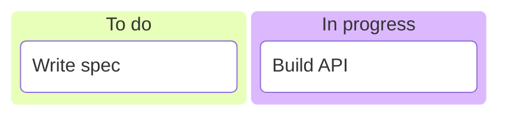

Traps: `accTitle` becomes a card; leave it out. Item metadata: `t1[Text]@{ assigned: 'name', ticket: 'ABC-1', priority: 'High' }`.

## Requirement (`requirementDiagram`)

Use to trace requirements to the elements that satisfy or verify them.

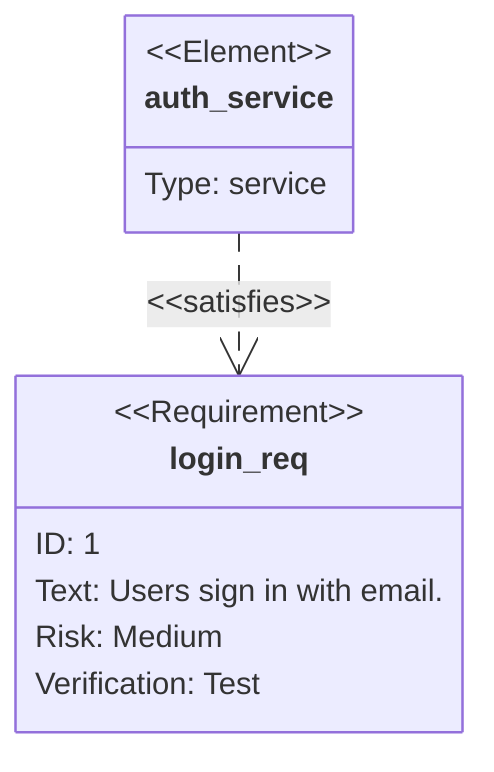

Traps: `risk` is `low`, `medium`, `high`; `verifymethod` is `analysis`, `inspection`, `test`,
`demonstration`. Relations: `contains`, `copies`, `derives`, `satisfies`, `verifies`, `refines`, `traces`.

## Radar (`radar-beta`)

Use to compare a few options scored on the same axes. Scores need a source.

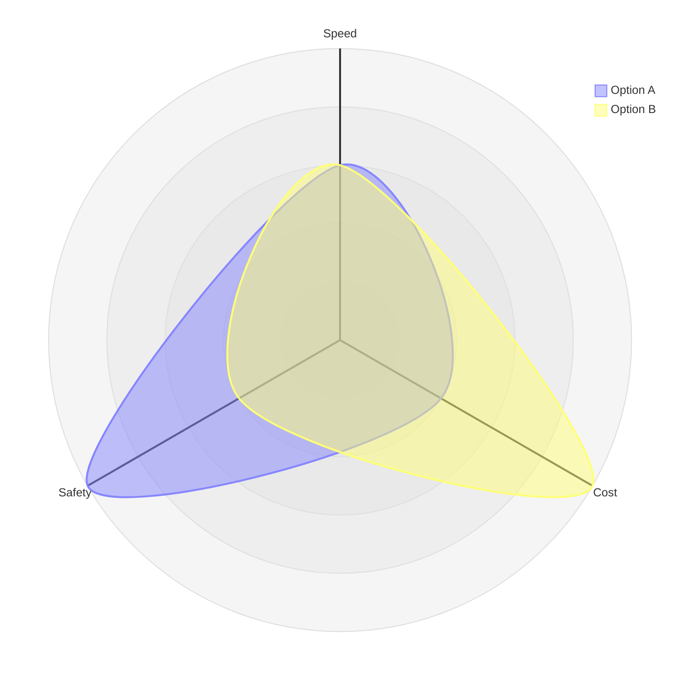

## Treemap (`treemap-beta`)

Use for a hierarchy where size matters: code size by module, cost by service.

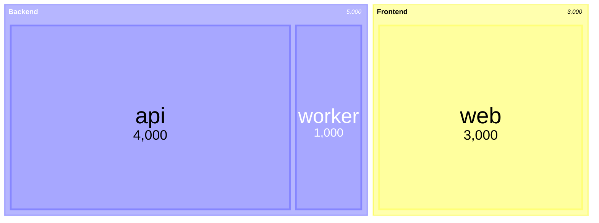

Traps: indentation decides the hierarchy; leaves have `: value`.

## Venn (`venn-beta`)

Use for overlap between two or three sets.

**Platform features.** Some features are shared by web and mobile.

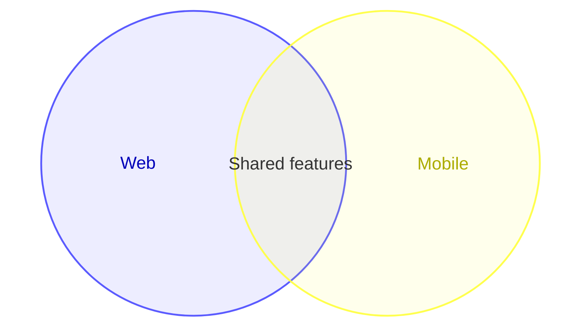

Traps: `accTitle` breaks it.

## Use case (`usecase-beta`)

Use for UML use cases: actors and what they can do inside a system boundary.

```mermaid
usecase-beta
  accTitle: Shop use cases
  accDescr: A customer can place an order and track it.
direction LR
actor Customer("Customer")
systemBoundary "Shop"
  Checkout("Place order")
  Track("Track order")
end
Customer --> Checkout
Customer --> Track
```

## Swimlane (`swimlane-beta`)

Use for a process across roles or teams, one lane each. On targets without it, a flowchart with one
subgraph per role is the fallback.

```mermaid
swimlane-beta LR
  accTitle: Order fulfilment across teams
  accDescr: The customer places an order, the warehouse ships it, and finance invoices it.
  subgraph Customer
    order[Place order]
  end
  subgraph Warehouse
    ship[Ship]
  end
  subgraph Finance
    invoice[Invoice]
  end
  order --> ship
  order --> invoice
```

## Tree view (`treeView-beta`)

Use for a folder tree. A fenced `text` tree in Markdown (DI-MD-04) works everywhere and is usually better.

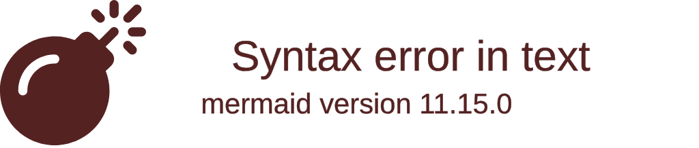

## Ishikawa (`ishikawa-beta`)

Use for a fishbone: causes of one effect grouped by category. Causes must be findings, not guesses.

**Slow checkout causes.** Found in the 2026-11 performance review.

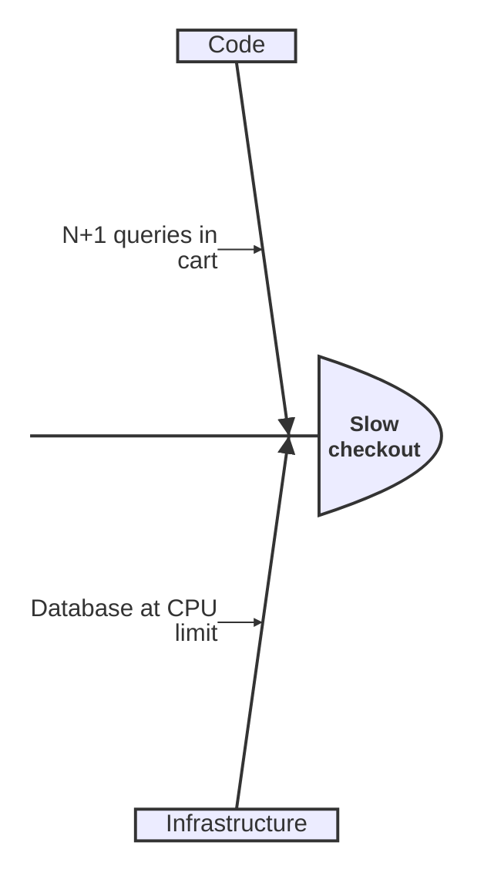

Traps: the first line under the keyword is the effect; indentation sets categories. `accTitle` becomes a branch.

## Cynefin (`cynefin-beta`)

Use to sort problems into the Cynefin domains: `clear`, `complicated`, `complex`, `chaotic`, `confusion`.

```mermaid
cynefin-beta
  accTitle: Incident types by Cynefin domain
  accDescr: Known fixes are clear; slow queries are complicated; unknown traffic is complex.
  title Incident types
  clear
    "Restart service"
  complicated
    "Analyze slow queries"
  complex
    "Unknown traffic pattern"
```

## Wardley map (`wardley-beta`)

Use for a value chain placed by visibility (y) and evolution (x), both 0 to 1.

```mermaid
wardley-beta
  accTitle: Shop value chain
  accDescr: Checkout depends on payments, which is a commodity.
title Shop value chain
anchor Customer [0.95, 0.6]
component Checkout [0.8, 0.5]
component Payments [0.5, 0.8]
Customer -> Checkout
Checkout -> Payments
```

Traps: coordinates are `[visibility, evolution]`. `evolve X 0.8` draws movement.

## Railroad (`railroad-ebnf-beta`, `railroad-abnf-beta`, `railroad-peg-beta`, `railroad-beta`)

Use to draw a grammar. Pick the keyword for the grammar notation you have.

```mermaid
railroad-ebnf-beta
  accTitle: Digit grammar
  accDescr: A digit is one of 0, 1, or 2.
title "Digit"

digit = "0" | "1" | "2" ;
```

## Event modeling (`eventmodeling`)

Use for Event Modeling: UI, commands, events, and read models on a timeline of frames.

**Add to cart.** The cart UI sends AddItem, which records ItemAdded.

```mermaid
eventmodeling

tf 01 ui CartUI
tf 02 cmd AddItem
tf 03 evt ItemAdded
```

Traps: each frame number must be unique. `accTitle` is ignored. Long form: `timeframe 02 command AddItem`.

## Agent flow (`agentflow-beta`)

Use for AI agent workflows: tasks, tool calls, decisions, inside a named flow.

```mermaid
agentflow-beta TB
  accTitle: Review agent flow
  accDescr: The agent gathers changes, then runs the linter tool.
  flow reviewer["Review agent"]
    changes["Gather changes"]@{ shape: input }
    lint["run_linter"]@{ shape: tool }
    changes --> lint
  end
```

## ZenUML (`zenuml`)

Use only when the team already writes ZenUML; prefer `sequenceDiagram`, which every target supports.
It needs the ZenUML plugin, which the validator loads but most platforms do not.

**Login call.** The browser posts to the API and gets 200.

```mermaid
zenuml
  title Login
  Browser->API: POST /login
  API->Browser: 200
```

Traps: `accTitle` is drawn as text.
