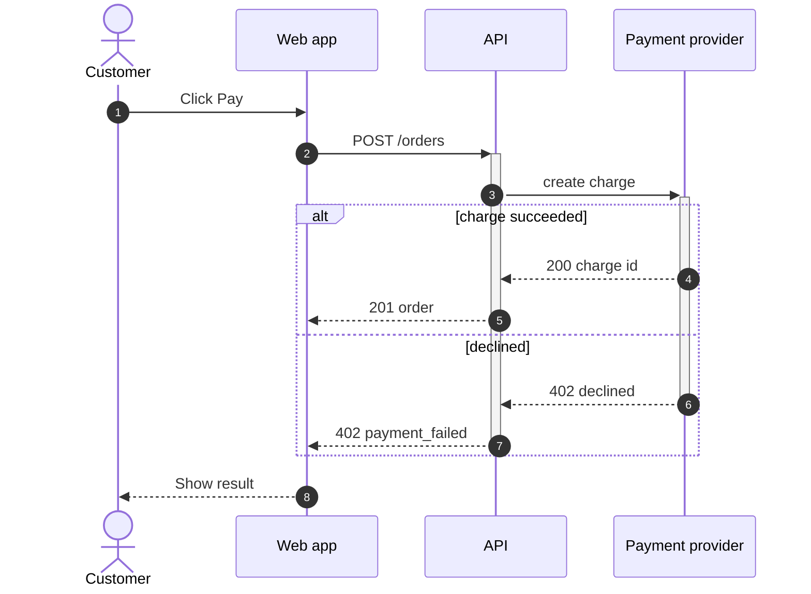

# Sequence diagram

> Who calls whom, in what order, and what comes back. Time runs down the page.

Use for one use case or request: an API call through its services, an auth handshake, a webhook, a
job. One sequence per flow. Not for the whole system (architecture), or for one object's lifecycle (state).

## Syntax essentials

| Need | Syntax |
| --- | --- |
| Participants in reading order | `participant A as API`, `actor U as User` (declare first, in order) |
| Sync call, reply, async message | `A->>B: msg`, `B-->>A: reply`, `A-)B: event` |
| Failed or lost message | `A-xB: msg` |
| Activation (who is busy) | `A->>+B: call` and `B-->>-A: reply`, or `activate B` / `deactivate B` |
| Branches, optional, repeat, parallel | `alt` / `else` / `end`, `opt`, `loop`, `par` / `and` |
| Error handling region | `critical` / `option` / `end`, `break` / `end` |
| Notes | `Note right of A: text`, `Note over A,B: text` |
| Grouping participants | `box Aqua Backend` ... `end` (colour optional) |
| Numbering | `autonumber` |

## Rules

### DI-SQ-01 [Required] One flow per diagram

- Do: Name the trigger and the end condition in `accDescr`. Draw one use case.
- Do not: Chain three flows in one diagram with notes like "later...".
- Check: the first message is the trigger; the last is the result the question asks about.

### DI-SQ-02 [Required] Messages are the source's calls

- Do: Use the method, route, topic, or event name from the code (`POST /orders`, `OrderPaid`,
  `charges.create`), and the status codes the code returns.
- Do not: Write "sends data", "processes", "returns response".
- Check: each message has a ledger row with `path:line`.

### DI-SQ-03 [Required] Replies and failures are drawn

- Do: Draw replies with `-->>`. Draw the error branches the code handles with `alt` or `break`, and
  timeouts or retries with `loop` or a `Note`. Use `-)` for fire-and-forget (queue, event).
- Do not: Show only requests, or only the success path when the question is about behaviour.
- Check: every sync call has a reply or a note saying why not.

### DI-SQ-04 [Preferred] Participants ordered by first use

- Do: Declare participants left to right in the order the flow reaches them, the caller first.
- Do not: Let Mermaid order them by first mention when that crosses arrows back and forth.

## From code

| Source | Becomes |
| --- | --- |
| route + handler | the first two participants and the trigger message |
| service and client calls inside the handler | messages in call order |
| `await` vs. queue publish | `->>` vs. `-)` |
| `try`/`catch`, status checks | `alt` / `else` with the codes returned |
| retry helpers, timeouts | `loop` with the count, or a `Note` with the timeout value from config |
| middleware (auth, rate limit) | a participant or a `Note over` the API, in middleware order |

## Pitfalls

- `;` in a message ends it; rephrase or write `#59;`.
- `end` inside a message text is fine; as a participant name, alias it: `participant e as end`.
- Deactivating a participant more often than it was activated fails the render ("Trying to
  inactivate an inactive participant"); keep `+` and `-` paired.
- More than 8 participants or 30 messages: split by phase (DI-CX-01).
