# State diagram

> One thing, its states, and what moves it between them.

Use for an entity's lifecycle (order, payment, subscription, ticket), a protocol, or a UI component's
modes. Not for a process with many actors (flowchart, sequence).

## Syntax essentials

```mermaid
stateDiagram-v2
  accTitle: Order status lifecycle
  accDescr: An order starts pending, becomes paid on payment, then shipped and delivered; pending orders can be cancelled, and paid orders refunded.
  [*] --> pending
  pending --> paid : payment succeeded
  pending --> cancelled : customer cancels
  paid --> shipped : label printed
  paid --> refunded : refund issued
  shipped --> delivered : carrier confirms
  delivered --> [*]
  cancelled --> [*]
  refunded --> [*]
  note right of paid : refund allowed only before shipping
```

| Need | Syntax |
| --- | --- |
| Start, end | `[*] --> s`, `s --> [*]` |
| Transition with trigger | `a --> b : event [guard]` |
| Display name | `state "Awaiting payment" as pending` |
| Composite state | `state active { ... }` |
| Choice, fork, join | `state check <<choice>>`, `<<fork>>`, `<<join>>` |
| Concurrent regions | `--` inside a composite state |
| Note | `note right of s : text` |
| Direction | `direction LR` |

## Rules

### DI-SD-01 [Required] [Hard Gate] States and transitions come from the code

- Do: Take the state set from the enum, constants, or DB constraint, and each transition from code
  that assigns the new state, with its trigger (handler, event, job) and guard.
- Do not: Add a transition because it "should" exist (paid → cancelled). A state with no code that
  leaves it is a terminal state or a finding.
- Check: each transition has a ledger row with the assignment's `path:line`.

### DI-SD-02 [Required] Label every transition with its trigger

- Do: `event [guard]` from the source: the API call, event name, job, or timeout.
- Do not: Leave transitions unlabelled when more than one leaves a state.

### DI-SD-03 [Preferred] Show every state, even unreachable ones

- Do: Draw every value of the enum. A state no code enters is drawn with a note "no transition found";
  that is often the most useful finding.

### DI-SD-04 [Contextual] Composite states for modes

- When: a group of states shares exits (any active state can be suspended).
- Do: Wrap them in a composite state with one exit edge instead of drawing the same edge from each.

## From code

| Source | Becomes |
| --- | --- |
| `enum Status`, status constants, DB `CHECK` | the state set |
| `order.status = 'paid'` in a handler | a transition into `paid`; the handler is the trigger |
| `if (order.status !== 'pending') throw` | the guard, and which states the transition leaves from |
| scheduled jobs that expire records | timed transitions (`after 24h`, from config) |

## Pitfalls

- Use `stateDiagram-v2`; it is the current renderer.
- State ids with spaces need `state "Long name" as id`.
- The first ` : ` after a transition starts the label; later colons are part of the label (`a --> b : retry: 3 times` works).
